<picture><source media="(prefers-color-scheme: dark)" srcset="assets/hero-dark.svg"></picture>

<picture><source media="(prefers-color-scheme: dark)" srcset="assets/about-dark.svg"></picture>

<picture><source media="(prefers-color-scheme: dark)" srcset="assets/stack-dark.svg"></picture>

<a href="https://github.com/lennoxrose/ash"><picture><source media="(prefers-color-scheme: dark)" srcset="assets/project-ash-dark.svg"></picture></a>&nbsp;<a href="https://github.com/lennoxrose/HyprWall"><picture><source media="(prefers-color-scheme: dark)" srcset="assets/project-hyprwall-dark.svg"></picture></a>

<picture><source media="(prefers-color-scheme: dark)" srcset="assets/stats-dark.svg"></picture>

<picture><source media="(prefers-color-scheme: dark)" srcset="assets/streak-dark.svg"></picture>

<picture><source media="(prefers-color-scheme: dark)" srcset="assets/wave-dark.svg"></picture>

<a href="https://lennox-rose.com/"><picture><source media="(prefers-color-scheme: dark)" srcset="assets/button-1-dark.svg"></picture></a>&nbsp;&nbsp;<a href="https://github.com/lennoxrose?tab=repositories"><picture><source media="(prefers-color-scheme: dark)" srcset="assets/button-2-dark.svg"></picture></a>&nbsp;&nbsp;<a href="https://ash-project.org/"><picture><source media="(prefers-color-scheme: dark)" srcset="assets/button-3-dark.svg"></picture></a>&nbsp;&nbsp;<a href="https://hub.ash-project.org/"><picture><source media="(prefers-color-scheme: dark)" srcset="assets/button-4-dark.svg"></picture></a>

